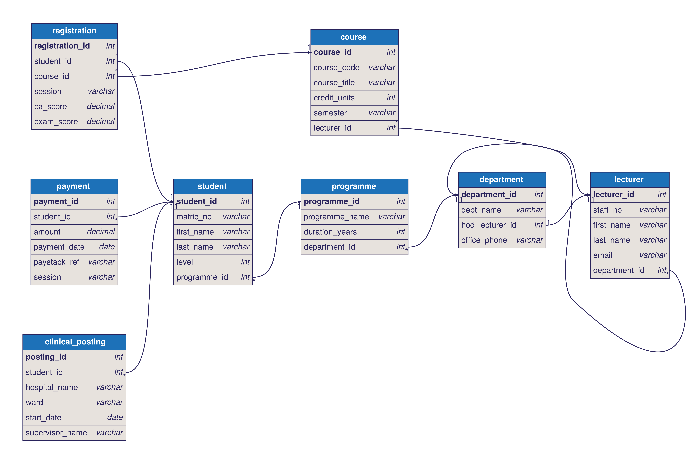

# Portfolio 1 – Database Design (OCNS)

ERD source code (dbdiagram.io / DBML): [ocns.dbml](ocns.dbml)

## Step 3: Tables

### 1. DEPARTMENT

| Column | Key |
|---|---|
| department_id | PK |
| dept_name | |
| hod_lecturer_id | FK → LECTURER (Head of Department) |
| office_phone | |

### 2. PROGRAMME

| Column | Key |
|---|---|
| programme_id | PK |
| programme_name | |
| duration_years | |
| department_id | FK → DEPARTMENT |

### 3. STUDENT

| Column | Key |
|---|---|
| student_id | PK |
| matric_no | |
| first_name | |
| last_name | |
| level | |
| programme_id | FK → PROGRAMME |

### 4. LECTURER

| Column | Key |
|---|---|
| lecturer_id | PK |
| staff_no | |
| first_name | |
| last_name | |
| email | |
| department_id | FK → DEPARTMENT |

### 5. COURSE

| Column | Key |
|---|---|
| course_id | PK |
| course_code | |
| course_title | |
| credit_units | |
| semester | |
| lecturer_id | FK → LECTURER |

### 6. REGISTRATION (in-between table for STUDENT and COURSE)

| Column | Key |
|---|---|
| registration_id | PK |
| student_id | FK → STUDENT |
| course_id | FK → COURSE |
| session | |
| ca_score | |
| exam_score | |

(student_id, course_id, session) is UNIQUE – a student can register for a course only once per session.

### 7. PAYMENT

| Column | Key |
|---|---|
| payment_id | PK |
| student_id | FK → STUDENT |
| amount | |
| payment_date | |
| paystack_ref | |
| session | |

### 8. CLINICAL_POSTING

| Column | Key |
|---|---|
| posting_id | PK |
| student_id | FK → STUDENT |
| hospital_name | |
| ward | |
| start_date | |
| supervisor_name | |

## How the tables connect

| Relationship | Type | FK goes in |
|---|---|---|
| One DEPARTMENT has many PROGRAMMES | 1 : M | PROGRAMME.department_id |
| One DEPARTMENT has many LECTURERS | 1 : M | LECTURER.department_id |
| One LECTURER heads one DEPARTMENT | 1 : 1 | DEPARTMENT.hod_lecturer_id |
| One PROGRAMME has many STUDENTS | 1 : M | STUDENT.programme_id |
| One LECTURER teaches many COURSES | 1 : M | COURSE.lecturer_id |
| Many STUDENTS take many COURSES (resolved by REGISTRATION) | M : N | REGISTRATION.student_id + REGISTRATION.course_id |
| One STUDENT makes many PAYMENTS | 1 : M | PAYMENT.student_id |
| One STUDENT has many CLINICAL_POSTINGS | 1 : M | CLINICAL_POSTING.student_id |

## Normalisation

**1NF – one value per box.**
I checked every column for lists or repeating groups. Each cell holds a single value: one phone number in `office_phone`, one hospital and one ward per clinical posting, one score per column in REGISTRATION. Names are already split into `first_name` and `last_name`, and a student's courses are not kept as a list in STUDENT – each course taken is its own row in REGISTRATION. Every table has a primary key, so no two rows are identical. Nothing needed fixing.

**2NF – every detail depends on the whole key.**
2NF only matters where a key has more than one part. REGISTRATION is identified by the combination (student_id, course_id, session). I checked each of its other columns: `ca_score` and `exam_score` depend on all three together – a particular student, in a particular course, in a particular session. Course details such as `course_title` and `credit_units` (which depend on course_id alone) and student details such as `matric_no` (which depend on student_id alone) are kept out of REGISTRATION and live only in COURSE and STUDENT. **Fix:** I added a UNIQUE rule on (student_id, course_id, session) so the same registration cannot be entered twice, while `registration_id` stays as a simple surrogate PK.

**3NF – no details about other details.**
I looked for any column that describes a different table rather than the row's own key. STUDENT holds only `programme_id`, not the programme name; COURSE holds only `lecturer_id`, not the lecturer's name; PAYMENT and CLINICAL_POSTING hold only `student_id`. **Problem found:** DEPARTMENT stored `hod_name`. The Head of Department is a lecturer, so their name was already stored in LECTURER – it would be written twice and could go out of date when the HOD changes. **Fix:** I replaced `hod_name` with `hod_lecturer_id` (FK → LECTURER), so the name is stored once and looked up. I also considered `hospital_name` in CLINICAL_POSTING: it repeats across postings, but since no other hospital facts (address, contact) are stored, it does not create a transitive dependency. If OCNS later records hospital details, a separate HOSPITAL table should be created.

**Result:** my schema is in 3NF because every cell holds a single value (1NF), every non-key column depends on the whole of its table's key (2NF), and no non-key column depends on another non-key column – each fact (a programme name, a course title, a lecturer's name) is stored in exactly one table and is reached from other tables through foreign keys (3NF). The ERD (`ocns-erd.png`) has been updated to show the HOD change.
