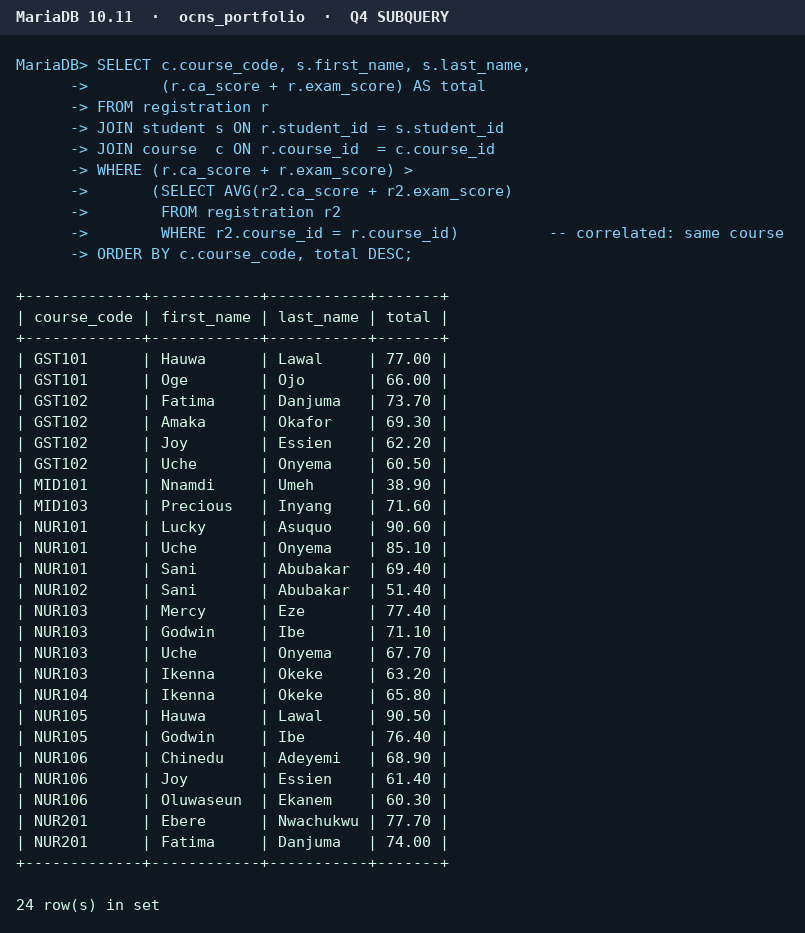
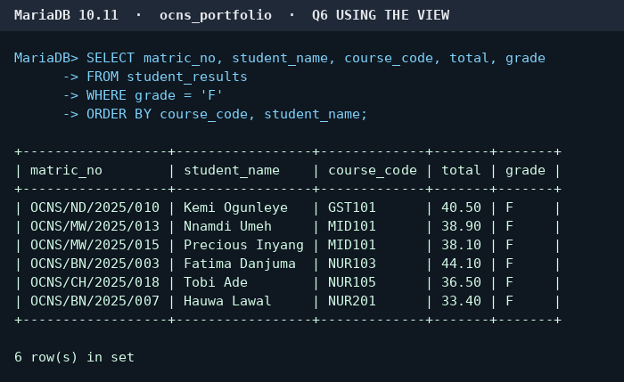
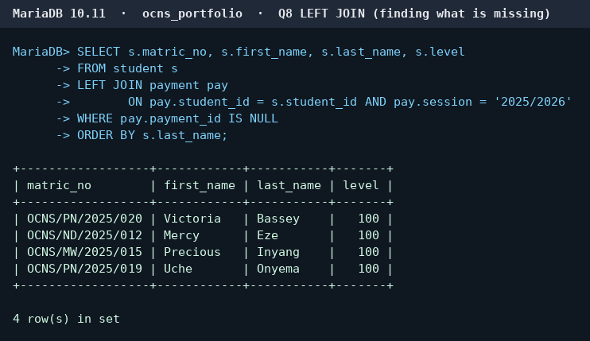
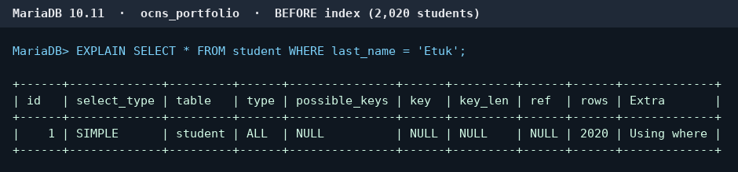
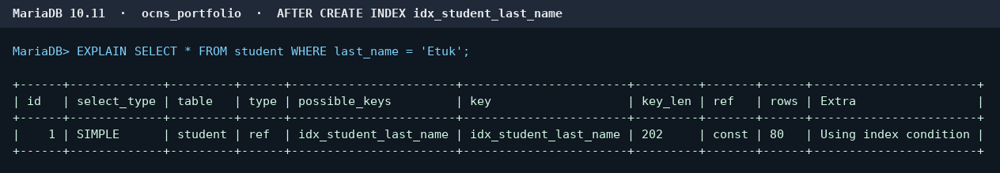

# Portfolio 2 – Query Optimisation (OCNS)

All queries run on the `ocns_portfolio` database built in Portfolio 1 (MariaDB 10.11, MySQL-compatible).
Code: [queries.sql](queries.sql) · [optimisation.sql](optimisation.sql)

## Part A – Queries the college actually asks

| # | Type | The question OCNS asks | Screenshot |
|---|---|---|---|
| Q1 | Simple filter | Which students are in 100 level (orientation list)? | [q1](q1_simple_filter.png) |
| Q2 | JOIN (3 tables) | Which students are registered for NUR101 this session? | [q2](q2_join.png) |
| Q3 | GROUP BY | What is the average total score per course, and how many sat it? | [q3](q3_group_by.png) |
| Q4 | Correlated subquery | Who scored above the class average in their own course? | [q4](q4_subquery.png) |
| Q5 | VIEW | A reusable `student_results` sheet with total and grade (A–F) | [q5](q5_view.png) |
| Q6 | Query on the view | Which students failed a course and need a resit? | [q6](q6_using_the.png) |
| Q7 | GROUP BY + HAVING | How much has the Bursary collected per programme (over ₦500,000)? | [q7](q7_group_by.png) |
| Q8 | LEFT JOIN | Which students have made no payment this session? | [q8](q8_left_join.png) |

## Part B – Making a query faster

**Query:** the Registry searching for a student by surname –
`SELECT * FROM student WHERE last_name = 'Etuk';`
To make the effect visible, 2,000 extra fictional students were added first (2,020 in total).

| | type | key used | rows examined |
|---|---|---|---|
| Before index | `ALL` (full table scan) | none | 2,020 |
| After `CREATE INDEX idx_student_last_name` | `ref` | idx_student_last_name | 80 |

## Analysis

I optimised the Registry's search for a student by surname, because staff look students up by name far more often than by ID. The query was slow because `last_name` is not a key, so MariaDB had no index on it and had to read the whole table. The first EXPLAIN shows this: `type = ALL` with no key used and 2,020 rows examined to find the 80 students called Etuk. After I created `idx_student_last_name`, the second EXPLAIN shows `type = ref` using the new index and only 80 rows examined – about 25 times fewer, and exactly the rows that match. The result of the query is the same (80 students); only the work needed to find them dropped. The gain grows with the table, so at the size of a full student database it would be the difference between scanning every record and jumping straight to the right ones. The downside is that every index must be kept up to date, so each INSERT, UPDATE or DELETE on `student` now does extra work, and the index takes up its own disk space. For that reason I would only index columns that are searched often, such as surname and matric number, and not every column in the table.
