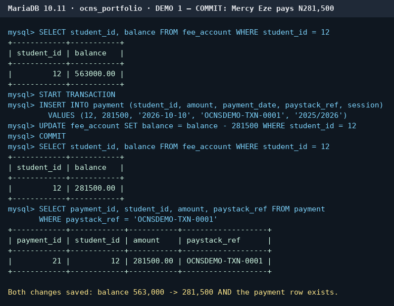
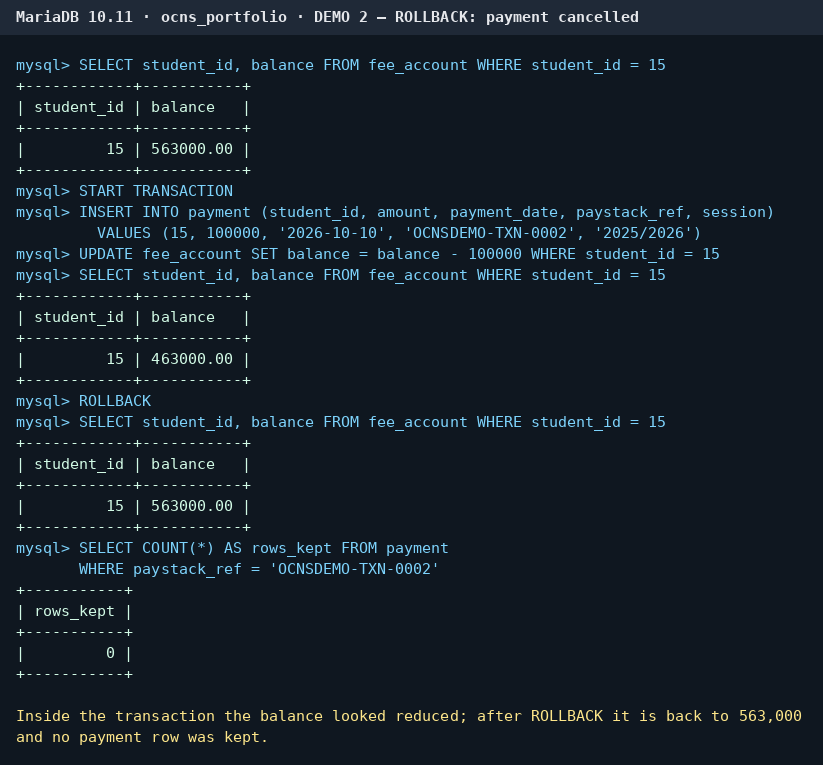
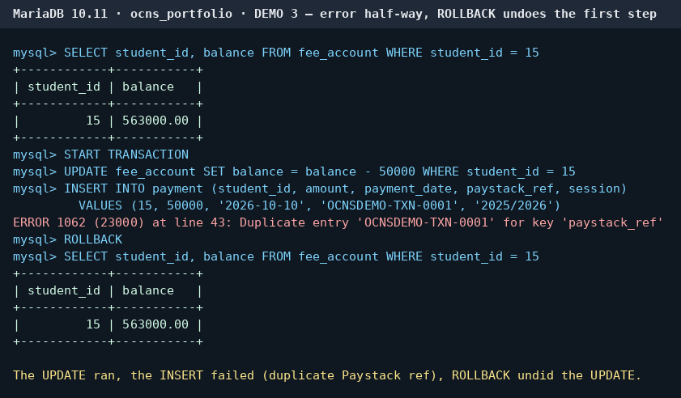
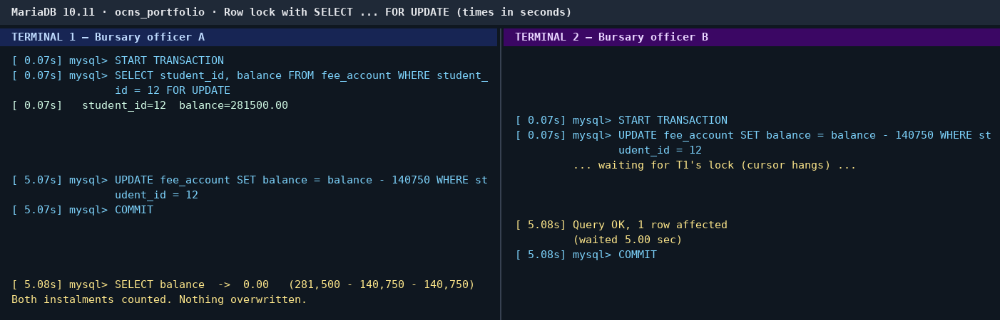
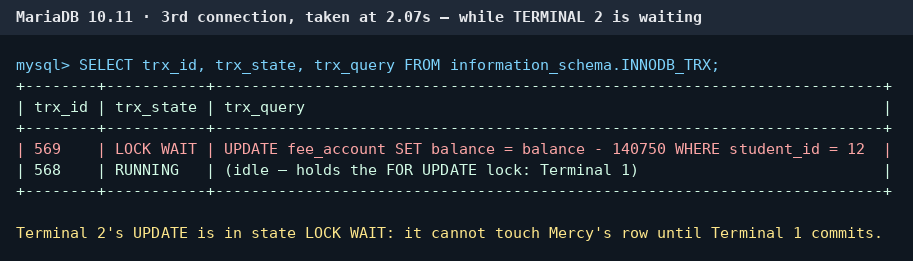
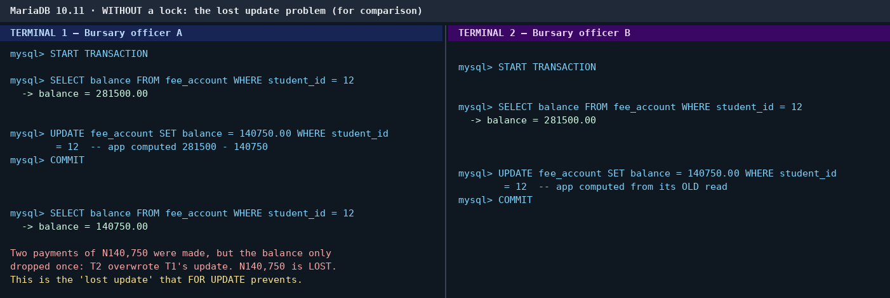
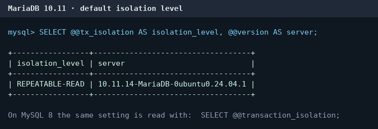

# Portfolio 3 – Transactions & Concurrency (OCNS)

Run on the `ocns_portfolio` database (MariaDB 10.11, InnoDB – all 9 tables checked).
Code: [setup_fee_account.sql](setup_fee_account.sql) · [transactions.sql](transactions.sql) · [concurrency.sql](concurrency.sql)

**Scenario.** When the Bursary records a fee payment, two things must change together: a new row in `payment` **and** the student's `balance` in `fee_account` (a small table added for this portfolio). If only one of them saved, the books would be wrong.

## ACID in one line each
- **Atomic** – the payment row and the balance change happen together or not at all.
- **Consistent** – rules such as `balance >= 0` and the unique Paystack reference are never broken, even half-way through.
- **Isolated** – two Bursary officers working at the same time cannot see or overwrite each other's unfinished work.
- **Durable** – once COMMIT returns, the payment survives a crash or a power cut.

## B. COMMIT – the success case
Mercy Eze (student 12) paid ₦281,500. Inside one transaction I inserted the payment and reduced her balance, then COMMITted. Afterwards her balance had dropped from ₦563,000 to ₦281,500 **and** the payment row was there – both changes were saved.

## C. ROLLBACK – the "something went wrong" case
Precious Inyang (student 15) started a ₦100,000 payment. Inside the transaction her balance showed ₦463,000, but after ROLLBACK it was back to ₦563,000 and no payment row was kept. In a second test a **real** error happened half-way: the balance UPDATE ran, then the INSERT failed because the Paystack reference had already been used (error 1062). ROLLBACK undid the UPDATE, so she was not charged for a payment that was never recorded.

## D. Concurrency – two officers, same student
Officer A ran `SELECT … FOR UPDATE` on Mercy's row, which locks it. Officer B then tried to take off the 3rd instalment and **waited 5.00 seconds**; a third connection showed B's transaction in state `LOCK WAIT`. As soon as A committed, B's update ran on the new balance and the final balance was ₦0.00 – both instalments counted.

**The problem the lock prevents – a lost update.** For comparison I repeated it without a lock, the way a careless app would: both officers read ₦281,500, each worked out ₦140,750, and each wrote that back. Two payments were made but the balance only dropped once, so the second write wiped out the first and the student would be chased for ₦140,750 they had already paid.

## E. Isolation levels
The server default is **REPEATABLE READ** (`SELECT @@tx_isolation;` on MariaDB, `SELECT @@transaction_isolation;` on MySQL 8).

| Level | What it allows |
|---|---|
| READ UNCOMMITTED | can see other people's unsaved changes (dirty reads) |
| READ COMMITTED | sees only saved data, but re-reading a row can give a new value |
| REPEATABLE READ | a row read twice in one transaction gives the same value |
| SERIALIZABLE | transactions behave as if they ran one after another |

**What OCNS should use.** I would keep **REPEATABLE READ** as the default: it stops dirty and non-repeatable reads without slowing down the busy result-checking and course-registration screens. For the few operations that change money or results, I would add `SELECT … FOR UPDATE` (as in Part D), which gives the same protection as SERIALIZABLE exactly where it is needed. Making the whole database SERIALIZABLE would cause many more waits during peak times such as registration week, when hundreds of students use the portal together.
